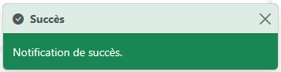
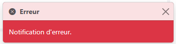
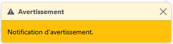
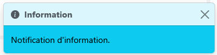
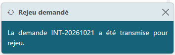

# Notifications toast

## Rôle

`XalToast` affiche des notifications Bootstrap destinées à informer l'utilisateur du résultat d'une action : succès, erreur, avertissement ou information. Une notification est créée à partir du template HTML, affichée dans le conteneur des toasts puis supprimée après sa fermeture.

Source : [`XalToast.js`](../XaliseConnect.Portal/wwwroot/js/components/XalToast.js).

## Initialisation et contrat DOM

Le module est initialisé par l'appel à la fonction `init()`. La méthode peut être appelée plusieurs fois : après une première initialisation réussie, les appels suivants sont sans effet.

Le module attend le template `#xal-id-toast-template-feedback`. Celui-ci doit être un élément `<template>` qui contient un unique élément racine `.xal-toast`, avec les éléments suivants :

- `.xal-toast__icon` : icône de la notification ;
- `.xal-toast__label` : titre de la notification ;
- `.xal-toast__message` : message de la notification.

Si le template ou l'un de ces éléments requis est absent ou invalide, `init()` lève une erreur. Le module clone le contenu du template pour chaque notification ; il ne modifie pas le template original.

## Variantes prédéfinies

Les méthodes prédéfinies appliquent un titre, une icône Bootstrap et une couleur cohérents avec la variante. Les valeurs de variante et les classes Bootstrap viennent de `XalConstants`.

| Méthode | Titre | Variante Bootstrap |
| --- | --- | --- |
| `success(message, options)` | Succès | `success` |
| `error(message, options)` | Erreur | `danger` |
| `warning(message, options)` | Avertissement | `warning` |
| `info(message, options)` | Information | `info` |

### Captures des variantes

**Succès**



**Erreur**



**Avertissement**



**Information**



Toutes ces méthodes acceptent un objet `options` facultatif contenant `delay`, en millisecondes. Le délai par défaut est de 5 000 ms.

```js
XalToast.success('La demande a été enregistrée.');
XalToast.error('Échec de sauvegarde.', { delay: 8000 });
```

## Notification personnalisée

`custom(options, delay)` affiche une notification dont le titre, l'icône et les classes CSS peuvent être choisis par l'appelant. L'objet `options` exige une propriété `message` de type chaîne ; `title`, `icon` et `color` sont facultatives et doivent également être des chaînes si elles sont fournies. Le paramètre `delay` est facultatif et vaut 5 000 ms par défaut.

```js
import { XalConstants } from '../core/XalConstants.js';

XalToast.custom({
    title: 'Rejeu demandé',
    message: 'La demande INT-20261021 a été transmise pour rejeu.',
    icon: XalConstants.cssClasses.bootstrapIcons.arrowRepeat,
    color: XalConstants.cssClasses.bootstrapTextBg.xalise,
});
```



Les classes `icon` et `color` peuvent contenir plusieurs classes CSS séparées par des espaces. Sans classe d'icône, l'élément d'icône est masqué.

## Règles d'affichage et de fermeture

- Chaque appel crée un élément toast indépendant ; plusieurs notifications peuvent être affichées simultanément.
- Le toast est inséré dans `.toast-container` lorsqu'il existe, sinon dans `document.body`.
- Bootstrap Toast est configuré avec `autohide: true` et le délai demandé.
- Le bouton de fermeture du template permet de fermer une notification avant la fin du délai.
- À la fermeture, l'instance Bootstrap est détruite et l'élément toast est retiré du DOM.
- Si l'insertion ou l'affichage échoue, le module détruit l'instance et retire l'élément avant de propager l'erreur.
- Un délai doit être un nombre fini supérieur ou égal à zéro. Un délai incorrect lève une `TypeError` ou une `RangeError`.

## Texte et sécurité

Le titre et le message sont insérés avec `textContent`. Le contenu fourni est donc toujours interprété comme du texte, jamais comme du HTML. Par exemple, `'<strong>Attention</strong>'` s'affiche avec les chevrons et les balises visibles. L'API ne propose pas d'option permettant d'injecter du HTML.

## Accessibilité et limites

Le template utilise `role="status"`, `aria-live="polite"` et `aria-atomic="true"`. L'icône est masquée aux technologies d'assistance avec `aria-hidden="true"`; le titre et le message fournissent l'information textuelle.

Toutes les variantes, y compris les erreurs, utilisent actuellement la région `status` avec une annonce polie. Le composant ne passe pas les erreurs en `role="alert"` / `aria-live="assertive"`. Il n'est donc pas conçu pour annoncer les erreurs comme des alertes urgentes.

## Vérification manuelle

Ajouter le paramètre `debug` à l'URL active l'exposition des composants de diagnostic. Le toast déjà initialisé est alors accessible dans la console du navigateur :

```js
window.xaliseDebug.XalToast.success('Notification de succès.');
window.xaliseDebug.XalToast.error('Erreur de test.');
window.xaliseDebug.XalToast.warning('Avertissement de test.');
window.xaliseDebug.XalToast.info('Information de test.');
```

Vérifier les icônes et couleurs, la fermeture automatique, le bouton de fermeture, ainsi que plusieurs notifications déclenchées rapidement. Pour confirmer que le message reste du texte brut :

```js
window.xaliseDebug.XalToast.custom({
    title: 'Test texte brut',
    message: '<strong>Cette balise doit rester visible comme du texte.</strong>',
});
```

Une valeur invalide permet de vérifier la validation du délai :

```js
window.xaliseDebug.XalToast.success('Test du délai', { delay: -1 });
```

Cet appel doit lever une `RangeError`.
